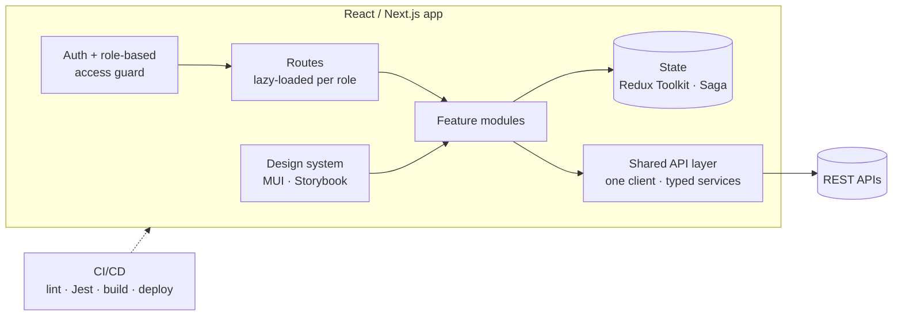

<a href="https://hemantpatil.vercel.app">
  <picture>
    <source media="(prefers-color-scheme: dark)" srcset="./assets/hero-dark.svg" />
    
  </picture>
</a>

  
  
  
  

  <a href="#impact">⚡ Impact</a> &nbsp;·&nbsp;
  <a href="#experience">🧭 Experience</a> &nbsp;·&nbsp;
  <a href="#architecture">🏗️ Architecture</a> &nbsp;·&nbsp;
  <a href="#stack">🛠️ Stack</a> &nbsp;·&nbsp;
  <a href="#projects">📌 Projects</a> &nbsp;·&nbsp;
  <a href="#activity">🐍 Activity</a> &nbsp;·&nbsp;
  <a href="#contact">🤝 Contact</a>

> [!TIP]
> **Open to work:** full-time Software Engineer roles and selected contract work. The fastest way to reach me is [email](mailto:patilhemantsing@gmail.com).

For about five years I've built production frontends for enterprise products, including **American Express, Pearson, Axis Bank and YES Securities**. Most of my work starts at the foundation: folder structure, a shared API layer, the auth and role-based access pattern, and state management. From there I tune performance until it shows up in Lighthouse and Core Web Vitals. I was promoted to Team Leader at Koli Infotech and led a team of 6 developers.

<picture><source media="(prefers-color-scheme: dark)" srcset="./assets/divider-dark.svg" /></picture>

## ⚡ Impact

<picture>
  <source media="(prefers-color-scheme: dark)" srcset="./assets/impact-dark.svg" />
  
</picture>

<picture><source media="(prefers-color-scheme: dark)" srcset="./assets/divider-dark.svg" /></picture>

## 🧭 Experience

<picture><source media="(prefers-color-scheme: dark)" srcset="./assets/timeline-dark.svg" /></picture>

▾ Click a role for the full story.

<b>Interstride</b> · Frontend Developer · <i>Jun 2025 – Sep 2026</i>

 

- Set up the folder structure, shared API layer, auth pattern and Redux Toolkit state layer for **4 role-based portals** used by **550+ universities** and **7 user roles**.
- Made the Student Portal **~40% faster** for **250,000+ students** with route-level lazy loading, fewer re-renders and a smaller bundle.
- Cut redundant API calls by **~55%** and made search and filter **~45% faster** with debounced search, sorting and pagination.
- Owned code review, CI/CD and frontend architecture for a team of 8.

<b>iauro Systems</b> · Software Engineer · client: YES Securities · <i>Feb – May 2025</i>

 

- Built independently deployable modules on a **React micro-frontend** architecture.
- Built a **Material UI component library** documented in **Storybook**.

<b>Koli Infotech</b> · React.js Developer → Team Leader · <i>Nov 2021 – Feb 2025</i>

 

- Promoted to **Team Leader** within two years; led 6 remote developers across enterprise engagements for **American Express, Pearson and Axis Bank**.
- **American Express:** built the hotel cancellation and refund modules with Redux Saga, with **100% Jest coverage** on every feature I owned.
- Built the company website and the Pearson project on **Next.js**.

Client and employer code is under NDA and isn't on GitHub. The repos below are my own.

<picture><source media="(prefers-color-scheme: dark)" srcset="./assets/divider-dark.svg" /></picture>

## 🏗️ How I structure a frontend

<b>▸ Click to open the diagram</b> — the pattern I set up on most projects

 

**Why it works:** each feature owns its UI, state slice and service calls, so teams ship in parallel. All network traffic goes through one API layer, which makes auth, error handling and request de-duplication a single change. Role-based routing keeps every portal's bundle small.

<picture><source media="(prefers-color-scheme: dark)" srcset="./assets/divider-dark.svg" /></picture>

## 🛠️ Tech stack

  <picture>
    <source media="(prefers-color-scheme: dark)" srcset="https://skillicons.dev/icons?i=react,nextjs,ts,js,redux,nodejs,materialui,tailwind,jest,githubactions,mongodb,mysql&theme=dark&perline=12" />
    
  </picture>

<picture><source media="(prefers-color-scheme: dark)" srcset="./assets/stack-dark.svg" /></picture>

<picture><source media="(prefers-color-scheme: dark)" srcset="./assets/divider-dark.svg" /></picture>

## 📌 Featured projects

  <a href="https://hemantpatil.vercel.app"><picture><source media="(prefers-color-scheme: dark)" srcset="./assets/project-portfolio-dark.svg" /></picture></a>
  <a href="https://github.com/hemantpatil135/multi-step-form"><picture><source media="(prefers-color-scheme: dark)" srcset="./assets/project-multi-step-form-dark.svg" /></picture></a>

  <a href="https://github.com/hemantpatil135/student-management-app"><picture><source media="(prefers-color-scheme: dark)" srcset="./assets/project-student-management-dark.svg" /></picture></a>
  <a href="https://github.com/hemantpatil135/react-big-calendar"><picture><source media="(prefers-color-scheme: dark)" srcset="./assets/project-big-calendar-dark.svg" /></picture></a>

Click a card to open it. Portfolio source: <a href="https://github.com/hemantpatil135/hemant-portfolio">hemant-portfolio</a>.

<picture><source media="(prefers-color-scheme: dark)" srcset="./assets/divider-dark.svg" /></picture>

## 🐍 Contribution activity

<picture>
  <source media="(prefers-color-scheme: dark)" srcset="https://raw.githubusercontent.com/hemantpatil135/hemantpatil135/output/github-snake-dark.svg" />
  
</picture>

Regenerated daily by a GitHub Action.

<picture><source media="(prefers-color-scheme: dark)" srcset="./assets/divider-dark.svg" /></picture>

## 🤝 Let's work together

I'm most useful on **React and Next.js performance**, **frontend architecture** (API layers, auth and role-based access, state) and **reusable TypeScript components**. If you're hiring, or you maintain a project in that space and could use help, open an issue or get in touch.

<a href="mailto:patilhemantsing@gmail.com"><picture><source media="(prefers-color-scheme: dark)" srcset="./assets/footer-dark.svg" /></picture></a>

  
  
  
  
  

<!-- Animated SVGs in ./assets are generated by scripts/build-assets.mjs (node scripts/build-assets.mjs). -->
